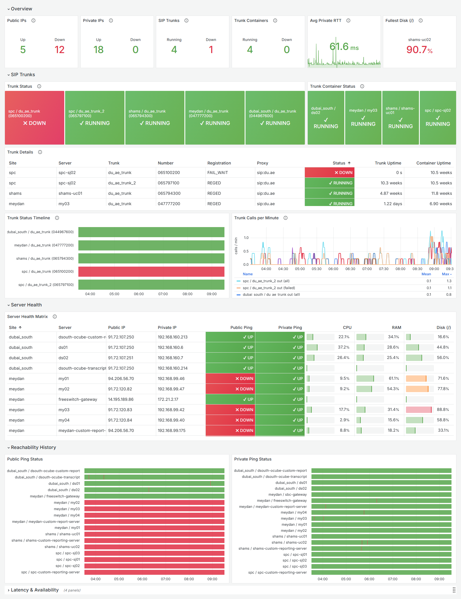
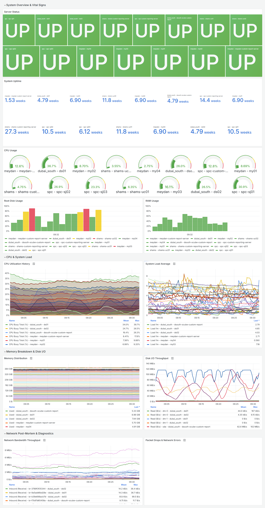
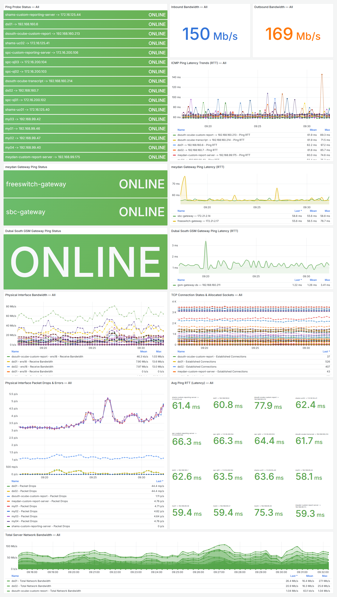
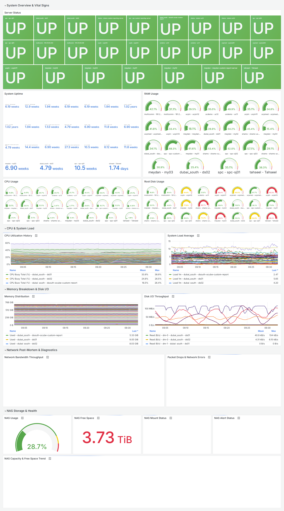
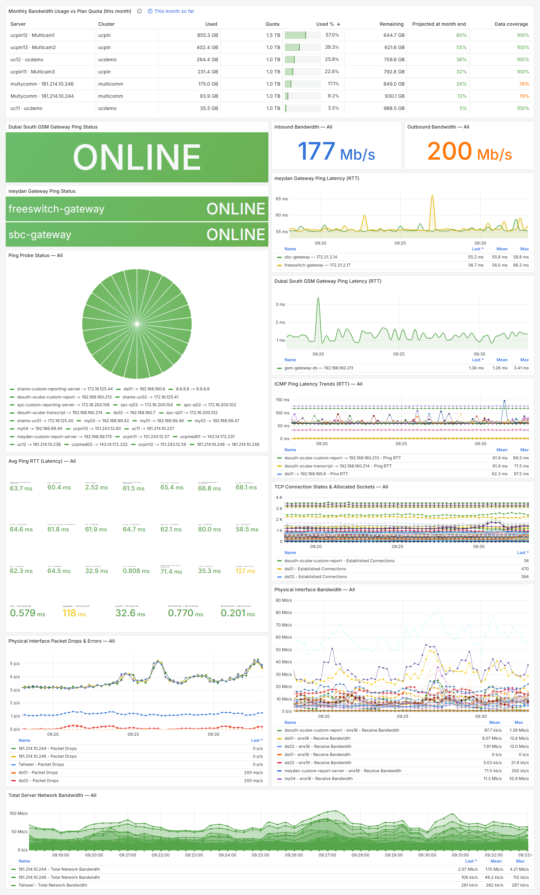
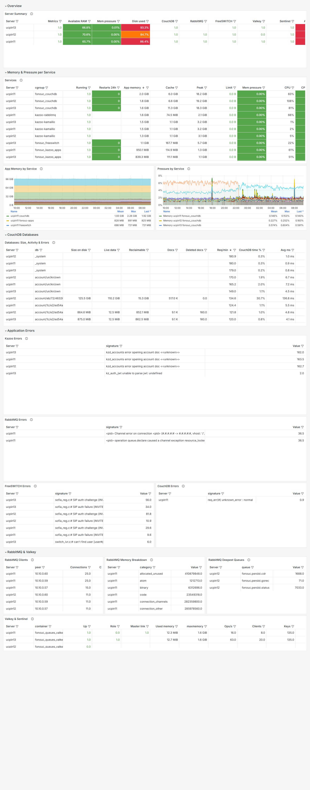
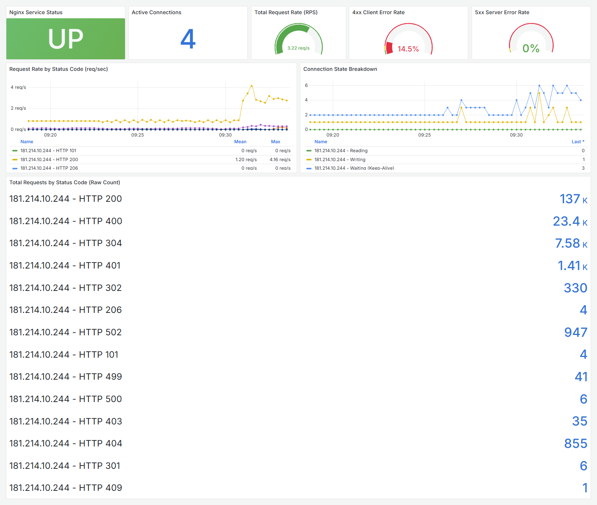
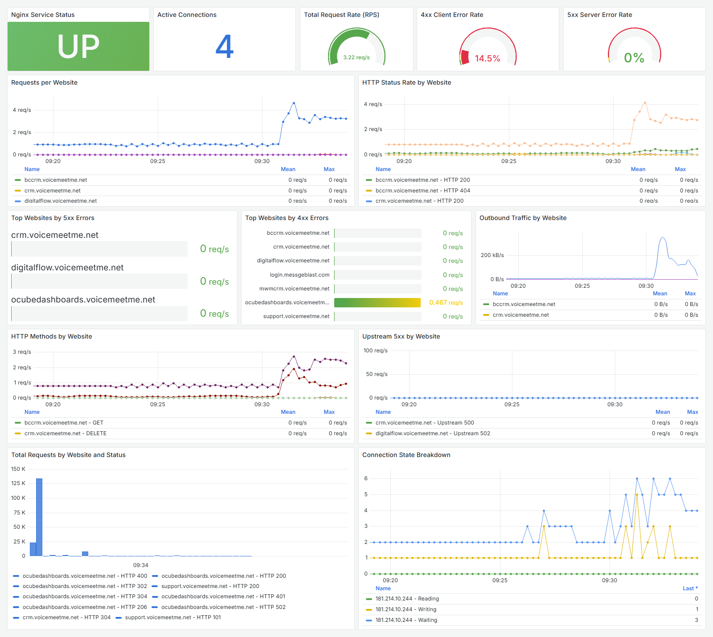
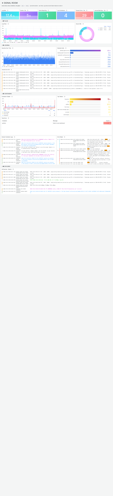

# OCube Dashboards – Working Dashboards Guide

Portal: https://ocubedashboards.voicemeetme.net (Grafana 10.4)

This guide covers the 9 dashboards that currently show live data. Metrics come from **Prometheus** (node_exporter on each server, Blackbox ping/TCP probes, custom collectors). Logs come from **Loki** (shipped by Grafana Alloy).

Every dashboard has drop-downs at the top (Cluster, Server, Site, Website, Host…). Changing them filters every panel on the page.

| # | Dashboard | Folder | Use it to answer |
|---|-----------|--------|------------------|
| 1 | Public & Private Infrastructure Availability | OCube | Is any site, server or SIP trunk down right now? |
| 2 | OCube Server System Overview | OCube | Are OCube servers short of CPU, RAM or disk? |
| 3 | OCube Server Fleet Network Diagnostics | OCube | Is there latency, packet loss or heavy traffic at an OCube site? |
| 4 | Debian Server Fleet Overview | Observability | Health of every server, plus the Tahseel NAS |
| 5 | Server Fleet Network Diagnostics | Observability | Network health of all servers, and monthly bandwidth vs plan quota |
| 6 | Kazoo Platform Health | Observability | Is the Kazoo voice platform running out of memory or throwing errors? |
| 7 | Custom Nginx Metrics Overview | Observability | Is Nginx up and serving without errors? |
| 8 | Nginx Proxy Manager – Website Monitoring | Observability | Which website is busy or failing? |
| 9 | Signal Room · System-Wide Logs | Observability | What are the logs saying, and where are the errors? |

---

## 1. Public & Private Infrastructure Availability

**What it does:** The main status board for the four OCube sites (Meydan, Shams, Dubai South, SPC). It pings every server twice, once on its **public IP** and once on its **private IP** (over VPN), checks every **SIP trunk** to the carrier, and shows each server's load. Start here when something is reported down.

**How to read it**

- **Overview (top tiles):** counts of public IPs up/down, private IPs up/down, SIP trunks running/down, and trunk containers running/down. Also shows average private ping time (ms) and the fullest root disk (orange from 70 %, red from 85 %).
- **SIP Trunks**
  - *Trunk Status:* one tile per trunk, showing RUNNING or DOWN.
  - *Trunk Container Status:* checks that the FreeSWITCH trunk container is running and answering on its control port (ESL 8023).
  - *Trunk Details:* the DID number, registration state (REGED = registered with the carrier), proxy and uptime of each trunk.
  - *Trunk Status Timeline:* when each trunk went up or down.
  - *Trunk Calls per Minute:* call volume per trunk. "Failed" calls include busy and no-answer, so failed calls alone don't mean the trunk is faulty.
- **Server Health Matrix:** one row per server, showing public ping, private ping, CPU, RAM and disk with colour bars.
- **Reachability History:** a timeline of ping up/down for every server.
- **Latency & Availability:** ping time (RTT) and % availability over time, for public and private pings.

**Key rules built in**

- **Public ping DOWN + private ping UP** usually means the site firewall blocks ping from outside. The server itself is fine.
- **Both pings DOWN** means a real outage or a network problem.
- If trunk data is older than 3 minutes, the trunk is shown as DOWN, so a broken collector can't hide a dead trunk.

---

## 2. OCube Server System Overview

**What it does:** Shows how hard each OCube site server is working (Meydan, Shams, Dubai South, SPC only).

**How to read it**

- **Vital Signs:** server up/down, uptime, CPU %, root disk % and RAM % (side-by-side bars to compare servers).
- **CPU & Load:** CPU split into user, system and iowait. High *iowait* means the disk is the bottleneck. *Load average* (1/5/15 min) shows whether load is rising or falling.
- **Memory & Disk I/O:** RAM split into used, cache, buffers and free (cache can be freed, so it's not "used up"), plus disk read/write speed.
- **Network:** traffic per network card, plus dropped packets and errors. These should stay near 0.

---

## 3. OCube Server Fleet Network Diagnostics

**What it does:** A network-only view of the OCube sites, used to chase slowness, latency or packet loss.

**How to read it**

- **Ping status, average ping time and inbound/outbound bandwidth** for the selected server.
- **Ping latency trend:** a rising line means the network path is getting slower.
- **Meydan gateways:** ping status and latency for the FreeSWITCH gateway and the SBC gateway.
- **Dubai South GSM gateway:** ping status and latency.
- **Interface bandwidth:** real network-card traffic in bits/s. Virtual interfaces (Docker, VPN, loopback) are left out.
- **TCP connections:** established connections, allocated sockets and TIME_WAIT. A sudden jump means a traffic spike or a connection leak.
- **Packet drops & errors:** anything above 0 points to a cable, network card or congestion problem.

---

## 4. Debian Server Fleet Overview

**What it does:** The same health view as dashboard 2, but for **every** server in every cluster (Meydan, Shams, Dubai South, SPC, UCPIN, UCDEMO, UCPMED, Multicomm, Tahseel). It adds a NAS section.

**How to read it**

- **Vital Signs, CPU & Load, Memory & Disk I/O, Network:** read these as in dashboard 2.
- **NAS Storage & Health:** covers the network share `/u2_nas` on the Tahseel server.
  - *NAS Usage %* and *Free Space*.
  - *Mount Status:* 1 = mounted, 0 = the share has disappeared.
  - *Alert Status:* number of NAS alerts currently firing.
  - *Capacity trend:* used vs free space over time, to see how fast it fills.

---

## 5. Server Fleet Network Diagnostics

**What it does:** Network diagnostics for all servers, plus a **bandwidth billing table**.

**Monthly Bandwidth Usage vs Plan Quota:** for each VPS (ucpin11/12/13, uc11/12, Multicomm .244/.246), the table shows:

| Column | Meaning |
|--------|---------|
| Used | Traffic in + out on the public interface this calendar month |
| Quota | The plan's monthly limit (1,500 GB for ucpin12, 1,024 GB for the others) |
| % Used | Used ÷ Quota |
| Projected | What usage will be at month end if the current rate continues |
| Data coverage | How much of this month Prometheus actually recorded. Below 95 % (orange), Used is lower than the provider's figure. |

The figures match the provider's control panel to within about 1 %. If a plan changes, update the quota number inside the panel query.

**Other panels:** ping, bandwidth, TCP, drops/errors and gateway panels, read as in dashboard 3, but covering all servers.

---

## 6. Kazoo Platform Health

**What it does:** Looks inside the Kazoo voice platform (Kazoo apps, Kamailio, FreeSWITCH, CouchDB, RabbitMQ, Valkey). It shows which service uses memory, which is waiting on resources, and which is logging errors. The data comes from node_exporter plus the collector script `scripts/kazoo_service_metrics.sh`, which runs every minute.

**How to read it**

- **Server Summary:** one row per Kazoo server.
  - Available RAM, memory pressure and disk used.
  - CouchDB, RabbitMQ, FreeSWITCH, Valkey and Sentinel: 1 = up, 0 = down, blank = not installed.
  - Firing alerts, active calls, CouchDB response time, RabbitMQ memory and queue size.
  - The age of the collector data.
- **Memory & Pressure per Service**
  - *Services table:* for each container or service, shows running state, restarts in 24 h, app memory, cache, peak, limit, CPU % and **pressure**. Pressure is the % of time the service was stuck waiting for memory, CPU or disk; 0 is good. OOM kills (the service was killed for using too much memory) should be 0.
  - *App Memory by Service:* stacked memory use against an 80 %-of-RAM line. If the stack reaches the line, the server needs tuning or more RAM.
  - *Pressure by Service:* only services that are really struggling appear.
- **CouchDB Databases:** for each database, shows size on disk, live data, *reclaimable* space (freed by compaction), document counts, requests per minute, share of CouchDB time, response time and 4xx/5xx errors. Use it to find the heaviest or slowest database.
- **Application Errors:** the most frequent error messages per minute from Kazoo, RabbitMQ, FreeSWITCH and CouchDB logs. Numbers and IDs are replaced with `#` so identical errors group together.
- **RabbitMQ & Valkey**
  - *RabbitMQ Clients:* connections and channels per client. Channels use broker memory.
  - *Memory Breakdown:* where RabbitMQ's memory goes.
  - *Deepest Queues:* queues with messages waiting. Empty means no backlog.
  - *Valkey & Sentinel:* up state, master/replica role, link status, memory, operations per second, clients, keys, **evicted keys (must stay 0)**, persistence status and Sentinel quorum.

---

## 7. Custom Nginx Metrics Overview

**What it does:** Shows the health of Nginx on the Multicomm servers. The data comes from a custom Python exporter.

**How to read it**

- **Service Status:** UP or DOWN.
- **Active Connections:** clients connected right now.
- **Request Rate (RPS):** requests per second.
- **4xx Error Rate:** share of requests rejected because of the client (bad URL, not logged in). A high value can be bots or broken links.
- **5xx Error Rate:** share of requests that failed on the server. This should stay near 0 %.
- **Request Rate by Status Code:** the trend for each HTTP code (200, 404, 502…).
- **Connection State:** reading (receiving a request), writing (sending a reply) and waiting (idle keep-alive).
- **Total Requests by Status Code:** running totals for each HTTP code.

---

## 8. Nginx Proxy Manager – Website Monitoring

**What it does:** The same Nginx data as dashboard 7, broken down **per website** (crm, bccrm, digitalflow, support, ocubedashboards…). Use the *Website* drop-down to focus on one site.

**How to read it**

- **Top tiles:** read as in dashboard 7.
- **Requests per Website / HTTP Status by Website:** which site is busy, and which codes it returns.
- **Top Websites by 5xx / 4xx Errors:** the 10 worst sites for errors.
- **Outbound Traffic by Website:** bandwidth each site sends out.
- **HTTP Methods by Website:** GET, POST, DELETE… per site.
- **Upstream 5xx by Website:** errors returned by the **application behind Nginx**, not by Nginx itself. If this rises, the app is the problem.
- **Total Requests by Website and Status:** cumulative totals.

---

## 9. Signal Room · System-Wide Logs

**What it does:** One screen for logs from all hosts and containers. Grafana Alloy collects the Linux system journal and Docker container logs into Loki. Filter with **Host**, **Log Source** (`system` or `docker`), **Container**, and the free-text **Search** box, which accepts regex and ignores case.

**How to read it**

- **Top tiles:** log lines per second, events in the last 5 min, hosts reporting, live containers, Docker error lines in 5 min, and system warnings or worse in 5 min.
- **Pulse:** log volume per source. A sudden spike means something happened.
- **Journal**
  - *Severity Over Time:* journal entries by severity.
  - *Noisiest Units:* the top 8 services writing logs. A service that suddenly tops this list is often crash-looping.
  - *Journal Live Tail:* the system log, live.
- **Containers**
  - *Container Chatter* and *Top Talkers:* log volume per container.
  - *Top Errors:* the most repeated error messages per container.
  - *Docker Container Logs:* cleaned-up log lines showing the message, the error and the component.
- **Error Radar:** any line from any source containing error, fail, panic, fatal, exception, denied or refused. Repeats are collapsed into one line.
- **Explorer:** raw logs filtered by the Search box.

Note: right now only one host (`wsl-test`) is sending logs. Production servers appear here once Alloy is installed on them.
